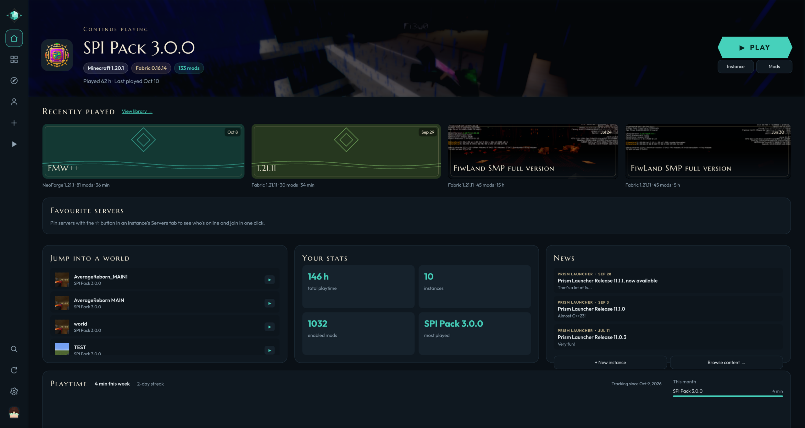
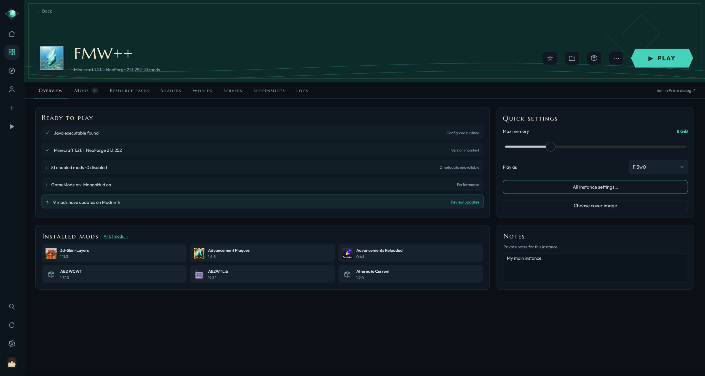
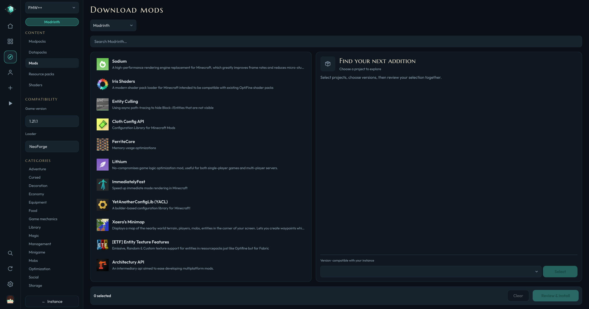
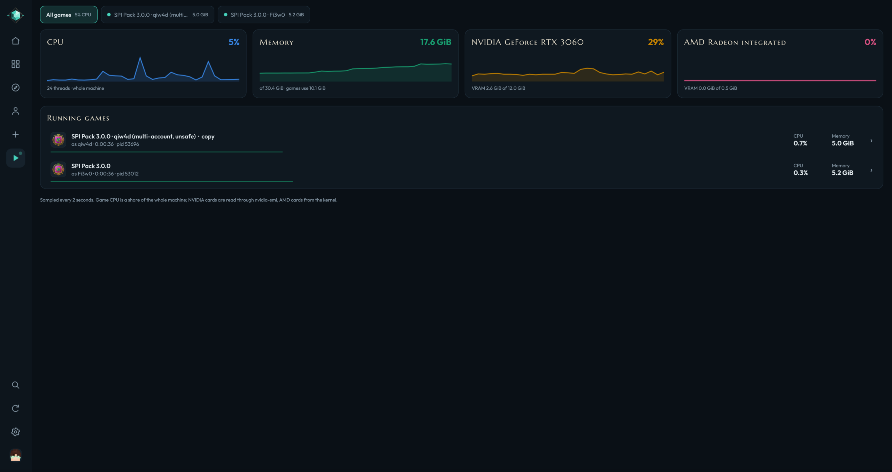
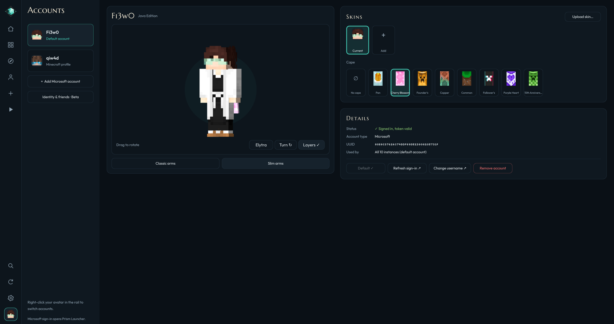

<div align="center">


# Prismarine

**A modern home for your Prism Launcher library.**

[](https://github.com/Fi3w0/Prismarine/actions/workflows/ci.yml)
[](https://github.com/Fi3w0/Prismarine/releases)
[](LICENSE)


[Screenshots](#screenshots) · [Features](#features) · [Install](#install) · [Build](#build-from-source) · [How it works](#how-it-works-with-prism) · [License](#license)

</div>

---

## Overview

Prismarine is a native desktop app for the instances you already have in
[Prism Launcher](https://prismlauncher.org). Browse and install mods and modpacks, keep
your library organised, follow your game's live log and hardware use, and get help
when something crashes, all in one deep-sea themed interface.

Prism still does the hard part: Microsoft sign-in, downloading the game and launching
it. Prismarine reads and writes the same instance folders, so you can switch between
the two at any time and nothing gets converted or locked in.

> **Beta.** It works, but it still needs improvements. Everything below works today on
> Linux, where it is used daily. Windows, macOS and FreeBSD builds come from CI and see
> less real-world use. If something breaks on your setup, please
> [open an issue](https://github.com/Fi3w0/Prismarine/issues).

---

## Screenshots

<table align="center">
  <tr>
    <td width="50%" align="center">
      
      <br><sub>Home: continue playing, saved worlds, stats and news</sub>
    </td>
    <td width="50%" align="center">
      
      <br><sub>An instance: overview, mods, packs, worlds and servers</sub>
    </td>
  </tr>
  <tr>
    <td width="50%" align="center">
      
      <br><sub>Browse Modrinth and CurseForge, filtered to your instance</sub>
    </td>
    <td width="50%" align="center">
      
      <br><sub>Now playing: every running game and your hardware at a glance</sub>
    </td>
  </tr>
  <tr>
    <td colspan="2" align="center">
      
      <br><sub>Accounts: skins and capes on a 3D model</sub>
    </td>
  </tr>
</table>

---

## Features

### Your library
- **Covers or rows**, search, loader filters, sorting, favourites and notes.
- **Prism's groups**: create, rename and delete them, and drag instances (or their cards) onto a group.
- **Card and banner art** per instance: generated artwork, any screenshot, or your own image.
- **Quick rename** with a double-click or F2, plus a right-click menu everywhere.
- **Ctrl+K** finds instances, worlds, servers, groups, settings and actions.

### Content
- **Browse Modrinth and CurseForge** for mods, resource packs, shaders, datapacks and full modpacks, filtered to your instance's version and loader.
- **Dependencies resolved** before anything installs, and every download is hash-verified.
- **Drag and drop** jars, packs and modpack archives onto the window or onto an instance.
- **Updates** for mods, resource packs, shaders and per-world datapacks.
- **Mod health**: duplicate mods, missing dependencies, incompatibilities and wrong-loader jars, each with a fix.
- **Mod profiles** to switch between saved sets of enabled mods.
- **Import and export** `.mrpack` and Prism ZIPs. *Share with friends* turns Modrinth-hosted files into downloads instead of copying them.

### Playing
- **Prismarine's own launch screen** with real steps (sign in, game files, Java, loading) and an **Abort** button.
- **Now playing**: a tab per running game with its live log, filters, memory and CPU, plus an **All games** view with CPU, RAM and GPU graphs.
- **Crash helper** that reads the log and crash report and explains the likely cause: missing dependencies, mixin conflicts, wrong Java, out of memory and more.
- **Favourite servers on Home** with live player counts and ping. Join launches straight in.
- **While playing**, Prismarine can stay open, minimise or hide (globally or per instance).
- **Multi-account play** *(experimental, off by default)*: run one instance with two accounts at once through a synced copy.

### Housekeeping
- **Storage** view of worlds, mods, screenshots, logs and caches per instance, with selective cleanup.
- **Shared content** *(optional)*: identical mods and packs across instances become hard links and use the space once.
- **Java**: find and test installed runtimes, or download a verified Eclipse Temurin.
- **Accounts**: default account, skin library and capes, previewed on a 3D model with an elytra view.
- **Network settings** for Prism's proxy, downloads and API overrides.
- **Themes**: Deep sea, Light or System, with your own accent colour.

---

## Install

You need **[Prism Launcher](https://prismlauncher.org/download/)** installed and signed in
once. Prismarine finds it and its instances on its own.

Grab the file for your system from the [latest release](https://github.com/Fi3w0/Prismarine/releases):

| System | Download | Notes |
| --- | --- | --- |
| **Any Linux** | `Prismarine-*-linux-x86_64.AppImage` | Make it executable and run it. Qt is bundled. |
| **Debian 13, Ubuntu 25.04+** | `prismarine_*_amd64.deb` | `sudo apt install ./prismarine_*.deb` |
| **Fedora** | `prismarine-*.x86_64.rpm` | `sudo dnf install ./prismarine-*.rpm` |
| **Arch Linux** | `prismarine-*.pkg.tar.zst` | `sudo pacman -U prismarine-*.pkg.tar.zst` |
| **Windows 10/11** | `Prismarine-*-windows-x64-setup.exe` | Or the portable `.zip`. No administrator rights needed. |
| **macOS 12+** | `Prismarine-*-macos-arm64.dmg` / `-x86_64.dmg` | Not notarised yet: right-click → Open the first time. |
| **FreeBSD 14** | `prismarine-*.pkg` | `sudo pkg add prismarine-*.pkg` |

A `SHA256SUMS.txt` comes with every release. Want the newest changes? The
[Nightly](https://github.com/Fi3w0/Prismarine/releases/tag/nightly) pre-release is rebuilt
from `main` on every push.

---

## Build from source

Requirements: **Qt 6.6+** (Base, Declarative, Quick3D, ShaderTools, Svg), **libarchive**,
**OpenSSL 3**, **CMake 3.21+** and a **C++17** compiler. **QtKeychain** is optional: it
enables the Friends feature and remembered CurseForge API keys.

```bash
# Arch
sudo pacman -S cmake ninja qt6-base qt6-declarative qt6-quick3d qt6-shadertools qt6-svg libarchive openssl qtkeychain-qt6

# Fedora
sudo dnf install cmake ninja-build gcc-c++ qt6-qtbase-devel qt6-qtdeclarative-devel qt6-qtquick3d-devel qt6-qtshadertools-devel qt6-qtsvg-devel libarchive-devel openssl-devel qtkeychain-qt6-devel

# Debian 13 / Ubuntu 25.04+
sudo apt install cmake ninja-build g++ qt6-base-dev qt6-declarative-dev qt6-quick3d-dev qt6-shadertools-dev qt6-svg-dev libarchive-dev libssl-dev qtkeychain-qt6-dev

# Gentoo
sudo emerge --ask dev-build/cmake dev-build/ninja dev-qt/qtbase dev-qt/qtdeclarative dev-qt/qtquick3d dev-qt/qtshadertools dev-qt/qtsvg app-arch/libarchive dev-libs/openssl dev-libs/qtkeychain

# FreeBSD
sudo pkg install cmake ninja qt6-base qt6-declarative qt6-quick3d qt6-shadertools qt6-svg libarchive
```

```bash
git clone https://github.com/Fi3w0/Prismarine.git
cd Prismarine
cmake -S . -B build -G Ninja -DCMAKE_BUILD_TYPE=Release
cmake --build build
./build/prismarine
```

Install it for your user (desktop entry and icons included) with
`cmake --install build --prefix ~/.local`. Useful options:

| Option | Default | What it does |
| --- | --- | --- |
| `PRISMARINE_KEYCHAIN` | `ON` | Use QtKeychain for the Friends identity and API keys |
| `PRISMARINE_DEPLOY_QT` | `OFF` | Copy Qt next to the app on install (Windows and macOS packages) |

Windows and macOS builds use Qt from the [online installer](https://www.qt.io/download-qt-installer-oss)
and libarchive and OpenSSL from [vcpkg](https://vcpkg.io). [`.github/workflows/ci.yml`](.github/workflows/ci.yml)
has the exact steps for every system and package.

### Handy flags

```bash
./build/prismarine --prism-data /path/to/PrismLauncher   # a different Prism folder
./build/prismarine --preferences /tmp/test.ini           # an isolated set of settings
./build/prismarine --page instance --instance "My Pack" --tab mods
./build/prismarine --page session --tab all              # the hardware view
./build/prismarine --page home --screenshot home.png     # render, save and quit
```

---

## How it works with Prism

- **Instances stay Prism's.** Prismarine edits the same `instance.cfg`, mod folders and
  `instgroups.json`, keeps every setting it does not understand, and writes files atomically.
- **Prism does the launching.** Play asks Prism to start the game, and Prismarine follows
  Prism's log and the game's own log to show progress. Microsoft sign-in also stays in Prism.
- **No surprise windows.** When Prismarine starts Prism, it loads a small Qt plugin into
  it (`src/prismquiet`) that keeps Prism's progress dialog and console out of sight unless
  you have opened Prism's own window. For setups where the plugin cannot load, there is
  also a [patch for Prism](packaging/prism-patch/README.md).
- **Nothing hidden.** No accounts, no telemetry. Network access is for Modrinth,
  CurseForge, Prism's news feed, server pings and, only when you ask, uploading a log to mclo.gs.

---

## About this project

I'm building Prismarine solo, and it's still in beta: it works, but there is plenty left to improve. I use AI coding agents to move fast, then
check the results on my own machine and library before I trust them. Bug reports are
genuinely useful: [open an issue](https://github.com/Fi3w0/Prismarine/issues) with your
system and what you were doing.

More from me: Minecraft mods on [Modrinth](https://modrinth.com/user/Fi3w0) and other
projects on [GitHub](https://github.com/Fi3w0).

---

## License

Prismarine's code is free software under the **GNU General Public License v3.0 only**.
See [LICENSE](LICENSE) and [NOTICE](NOTICE).

The **Prismarine name and logos are not covered by the GPL.** The artwork in
`assets/logos/` is under [CC BY-NC-ND 4.0](assets/logos/LICENSE), and forks must use their
own name and artwork. See [TRADEMARKS.md](TRADEMARKS.md). Fonts are under the
[SIL Open Font License 1.1](assets/fonts/OFL.txt).

<sub>Not an official Minecraft product. Not approved by or associated with Mojang or Microsoft.
Not affiliated with the Prism Launcher project.</sub>
