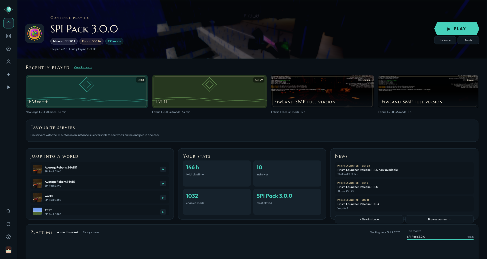
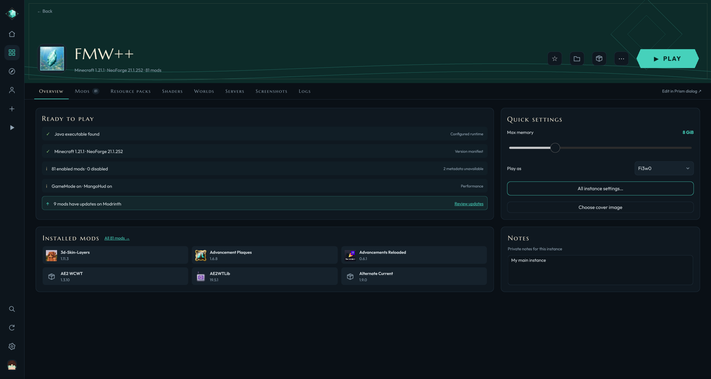
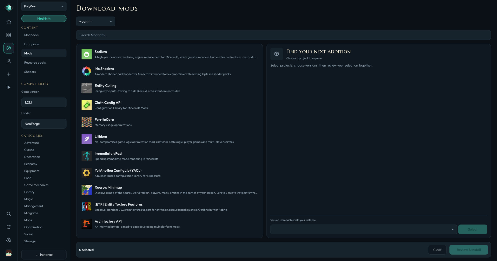
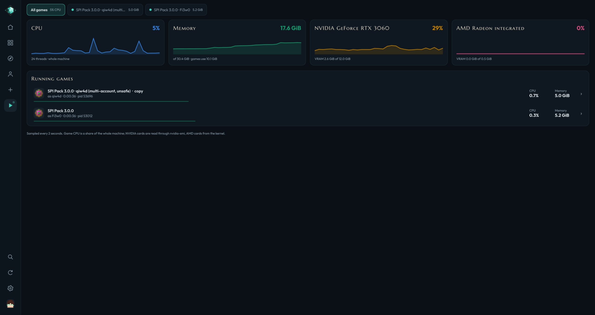
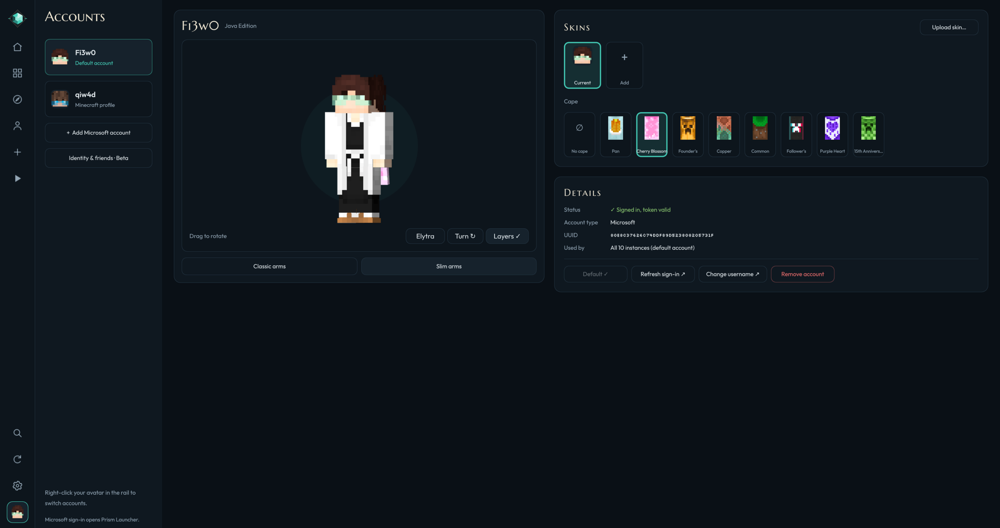
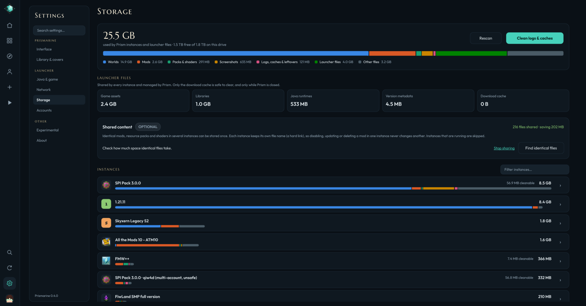

<div align="center">


# Prismarine

**A native Minecraft launcher powered by Prism Launcher.**

[](https://github.com/Fi3w0/Prismarine/actions/workflows/ci.yml)
[](https://github.com/Fi3w0/Prismarine/releases)
[](LICENSE)

[](https://github.com/sponsors/Fi3w0)
[](https://ko-fi.com/fi3w0)


[Screenshots](#screenshots) · [Features](#features) · [Install](#install) · [Build](#build-from-source) · [How it works](#how-it-works-with-prism) · [Documentation](DOCUMENTATION.md) · [Changelog](CHANGELOG.md) · [License](#license)

</div>

---

## Overview

Prismarine is a native Minecraft launcher for the instances you already have in
[Prism Launcher](https://prismlauncher.org). Browse and install mods and modpacks, organise
your library, follow your game's live log and hardware use, and get help when something
crashes, all in one deep-sea themed interface.

**You need Prism Launcher too.** Prismarine provides the interface and library tools, and
Prism handles Microsoft sign-in, downloading Minecraft and launching games. Both apps use
the same instance folders, so you can switch between them without converting anything.

> **Beta.** Everything below works on Linux, where I use it daily. Windows, macOS and FreeBSD
> builds come from CI and see less real-world use. If something breaks on your setup, please
> [open an issue](https://github.com/Fi3w0/Prismarine/issues).

---

## Screenshots

<table align="center">
  <tr>
    <td width="50%" align="center">
      
      <br><sub>Home: continue playing, saved worlds, stats and news</sub>
    </td>
    <td width="50%" align="center">
      
      <br><sub>An instance: overview, mods, packs, worlds and servers</sub>
    </td>
  </tr>
  <tr>
    <td width="50%" align="center">
      
      <br><sub>Browse Modrinth and CurseForge, filtered to your instance</sub>
    </td>
    <td width="50%" align="center">
      
      <br><sub>Now playing: every running game and your hardware at a glance</sub>
    </td>
  </tr>
  <tr>
    <td width="50%" align="center">
      
      <br><sub>Accounts: skins and capes on a 3D model</sub>
    </td>
    <td width="50%" align="center">
      
      <br><sub>Storage: disk usage, shared content and safe cleanup</sub>
    </td>
  </tr>
</table>

---

## Features

- **Library:** covers, groups, search, favourites and notes for your Prism instances.
- **Content:** browse Modrinth and CurseForge, resolve dependencies, update mods and packs,
  and import or export modpacks.
- **Playing:** launch progress, live logs, hardware graphs, crash explanations and guided
  recovery after a failed launch.
- **Controller:** move around every page and dialog with a game controller.
- **Your setup:** a palette editor, interface size, library density, Java, skins, storage and
  network settings.

See the [usage reference](DOCUMENTATION.md) for the feature details, shortcuts,
command-line options, and troubleshooting.

---

## Install

You need **[Prism Launcher](https://prismlauncher.org/download/)** installed and signed in
once. Prismarine finds it and its instances on its own.

For custom executables, data folders, and sandboxed installations, see
[Prism detection](DOCUMENTATION.md#prism-detection-and-data).

The latest published beta is **[0.4.0 Beryllium](https://github.com/Fi3w0/Prismarine/releases/tag/v0.4.0)**.
This source is **0.5.0 Boron**, which is not released yet. See the [changelog](CHANGELOG.md),
and grab the file for your system from [GitHub Releases](https://github.com/Fi3w0/Prismarine/releases):

| System | Download | Notes |
| --- | --- | --- |
| **Any Linux** | `Prismarine-*-linux-x86_64.AppImage` | Make it executable and run it. Qt is bundled. |
| **Debian 13, Ubuntu 25.04+** | `prismarine_*_amd64.deb` | `sudo apt install ./prismarine_*.deb` |
| **Fedora** | `prismarine-*.x86_64.rpm` | `sudo dnf install ./prismarine-*.rpm` |
| **Arch Linux** | `prismarine-*.pkg.tar.zst` | `sudo pacman -U prismarine-*.pkg.tar.zst` |
| **Gentoo** | [Live ebuild / local overlay](packaging/README.md#gentoo) | Builds `main`; optional `keychain` and `controller` USE flags. |
| **Nix / NixOS** | [Flake, module, and Nix closure](packaging/README.md#nix) | Qt and QML runtime paths are wrapped. |
| **Void Linux** | [XBPS template / package](packaging/README.md#void-linux) | `x86_64` glibc binary; build locally for musl. QtKeychain disabled. |
| **Windows 10/11** | `Prismarine-*-windows-x64-setup.exe` | Or the portable `.zip`. No administrator rights needed. |
| **macOS 12+** | `Prismarine-*-macos-arm64.dmg` / `-x86_64.dmg` | Not notarised yet: right-click → Open the first time. |
| **FreeBSD 14** | `prismarine-*.pkg` | `sudo pkg add prismarine-*.pkg` |

A `SHA256SUMS.txt` comes with every release. Want the newest changes? The
[Nightly](https://github.com/Fi3w0/Prismarine/releases) pre-release is rebuilt
from `main` on every push.

Packages appear after all required CI builds pass. The Gentoo, Nix, and Void
recipes live here; they are not yet in the official distribution repositories.

---

## Build from source

Requires Qt 6.6+ with Quick3D, libarchive, OpenSSL 3, CMake 3.21+, and a C++17
compiler. QtKeychain and SDL2 are optional. See the [technical report](TECHNICAL_REPORT.md#building)
for platform dependencies and build options, or use the
[source installers](install/README.md).

```sh
git clone https://github.com/Fi3w0/Prismarine.git
cd Prismarine
cmake -S . -B build -G Ninja -DCMAKE_BUILD_TYPE=Release
cmake --build build
./build/prismarine
```

Install for your user with `cmake --install build --prefix ~/.local`.
Contributors should also read [the validation instructions](CONTRIBUTING.md#check-your-change).

---

## How it works with Prism

Prismarine manages the same instances and asks Prism to launch them. Prism keeps Microsoft
sign-in and game preparation. A small Qt plugin keeps compatible Prism launch windows out of
the way while Prismarine shows progress.

See [the technical report](TECHNICAL_REPORT.md#architecture) for the integration
and its compatibility limits.

---

## Documentation

- [Usage reference](DOCUMENTATION.md): library/content tools, shortcuts, and CLI.
- [Technical report](TECHNICAL_REPORT.md): architecture, builds, and validation.
- [Changelog](CHANGELOG.md) and [developer history](DEV_CHANGELOG.md).
- [Plans, research, and reports](docs/README.md).

---

## About this project

I'm building Prismarine solo, and there is plenty left to improve. I use AI coding agents to
move fast, then check the results on my own machine and library before I trust them. Bug
reports help a lot: [open an issue](https://github.com/Fi3w0/Prismarine/issues) with your
system and what you were doing.

More from me: Minecraft mods on [Modrinth](https://modrinth.com/user/Fi3w0) and other
projects on [GitHub](https://github.com/Fi3w0).

## Contributing and support

Bug reports, packaging fixes, and pull requests are welcome. See
[CONTRIBUTING.md](CONTRIBUTING.md) for build checks and contribution rules, or
[open an issue](https://github.com/Fi3w0/Prismarine/issues/new/choose) using the
bug or feature form. Report vulnerabilities privately as described in
[SECURITY.md](SECURITY.md).

If you want to support my work, there's [GitHub Sponsors](https://github.com/sponsors/Fi3w0)
and [Ko-fi](https://ko-fi.com/fi3w0). Testing and useful bug reports help too.

---

## License

Prismarine's code is free software under the **GNU General Public License v3.0 only**.
See [LICENSE](LICENSE) and [NOTICE](NOTICE).

The **Prismarine name and logos are not covered by the GPL.** The artwork in
`assets/logos/` is under [CC BY-NC-ND 4.0](assets/logos/LICENSE), and forks must use their
own name and artwork. See [TRADEMARKS.md](TRADEMARKS.md). Fonts are under the
[SIL Open Font License 1.1](assets/fonts/OFL.txt).

<sub>Not an official Minecraft product. Not approved by or associated with Mojang or Microsoft.
Not affiliated with the Prism Launcher project.</sub>
